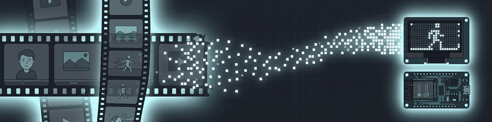
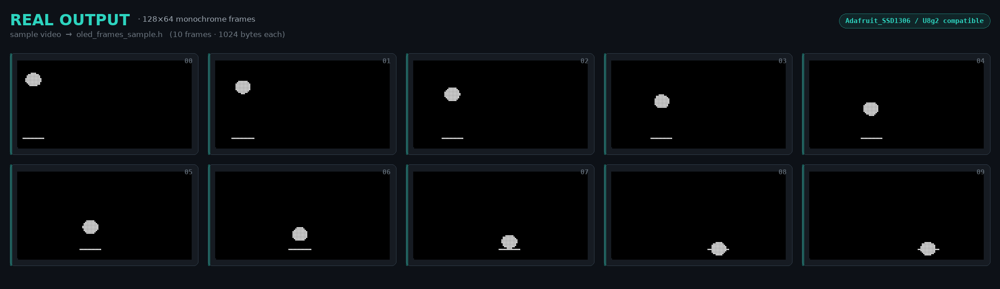

<div align="center">



# 🎬 OLED Video Converter

**تبدیل ویدیو به انیمیشنِ نمایشگر OLED ۱۲۸×۶۴ — برای ESP32 و Arduino**

[](https://www.python.org/)
[](https://www.gradio.app/)
[](https://opencv.org/)
[](LICENSE)
[](../../pulls)

ویدیو آپلود کن ⏵ تنظیمات رو بچین ⏵ فایل `.h` رو دانلود کن ⏵ روی OLED پخشش کن ✨

</div>

---

<div dir="rtl">

## ✨ چرا این ابزار؟

می‌خوای روی نمایشگر کوچولوی OLED ۰.۹۶ اینچی‌ات ویدیو پخش کنی؟ این ابزار دقیقاً همون کار رو می‌کنه:
ویدیوی ورودی رو به **فریم‌های بیت‌مپ تک‌رنگ** با فرمت استاندارد تبدیل می‌کنه و یک فایل هدر `C/C++` آماده‌ی آپلود بهت تحویل می‌ده — بدون حتی یک خط کدنویسی!

## 🖼️ پیش‌نمایش خروجی واقعی

این تصویر، خروجیِ واقعی خود ابزار از یک ویدیوی نمونه است (فریم‌های ۱۲۸×۶۴، هر فریم ۱۰۲۴ بایت):

<p align="center">
  
</p>

## 🚀 اجرای سریع

```bash
git clone https://github.com/erfan0086/python-project.git
cd python-project
pip install -r requirements.txt
python app.py
```

بعدش فقط مرورگر رو باز کن → `http://127.0.0.1:7860` 🎉

> 💡 اگه خواستی لینک عمومی هم بگیری: `GRADIO_SHARE=1 python app.py`

## ⚙️ تنظیمات

| تنظیم | توضیح | پیشنهاد |
|---|---|---|
| 🎞️ حداکثر تعداد فریم | چند فریم استخراج بشه | ۲۰ تا ۶۰ فریم |
| ⏩ رد کردن فریم (Frame Skip) | از هر N فریم، فقط یکی برداشته می‌شه | ویدیوی عادی: `2` |
| 🎚️ آستانه سیاه‌وسفید (Threshold) | نقطه‌ی جدایی سیاه از سفید | پس‌زمینه‌ی روشن: بالاتر |
| 🔄 معکوس کردن رنگ (Invert) | سیاه ↔ سفید | برای پس‌زمینه‌ی تیره |

## 🔌 استفاده روی ESP32 در ۳ قدم

۱. فایل دانلودشده رو با نام **`oled_frames.h`** کنار اسکچ Arduino کپی کن.
۲. اسکچ آماده‌ی [`examples/ESP32_OLED_Player.ino`](examples/ESP32_OLED_Player.ino) رو باز کن (فقط کتابخانه‌های `Adafruit SSD1306` و `Adafruit GFX` لازمه).
۳. آپلود کن و لذت ببر! 🎉

**سیم‌کشی (I2C):** `VCC → 3V3` · `GND → GND` · `SDA → GPIO21` · `SCL → GPIO22`

> 💡 سرعت پخش با ثابت `FRAME_DELAY_MS` داخل اسکچ قابل تغییره (۱۰۰ ≈ ۱۰ FPS).

## 🧩 چه چیزی تحویل می‌گیری؟

فایل `.h` تولیدشده شامل همه‌ی فریم‌ها + آرایه‌ی اشاره‌گرهاست و مستقیم با `display.drawBitmap(...)` کتابخانه‌ی Adafruit_GFX کار می‌کنه. یه نمونه‌ی واقعی هم اینجاست: [`examples/sample_output/oled_frames_sample.h`](examples/sample_output/oled_frames_sample.h)

```cpp
// فرمت خروجی: ردیفی، ۸ پیکسل در هر بایت، MSB اول
static const unsigned char PROGMEM frame_0[] = {
  0x00, 0x00, 0x00, 0xFF, 0xFF, 0x00, ...
};
const unsigned char* const frames[] PROGMEM = { frame_0, frame_1, ... };
```

## 📁 ساختار پروژه

```
📦 python-project
├── 🐍 app.py                        ← اپلیکیشن Gradio (قلب پروژه)
├── 📋 requirements.txt
├── 🖼️ assets/
│   ├── banner.png                   ← بنر پروژه
│   └── oled_preview.png             ← پیش‌نمایش خروجی واقعی
├── 📂 examples/
│   ├── 🔌 ESP32_OLED_Player.ino     ← اسکچ آماده‌ی پخش روی ESP32
│   └── 📂 sample_output/
│       └── 📄 oled_frames_sample.h  ← نمونه‌ی خروجی واقعی
├── 📜 LICENSE
└── 📖 README.md
```

</div>

---

## 🇬🇧 English

**Turn any video into a 128×64 monochrome OLED animation for ESP32 / Arduino.**
Upload a video → tune the settings → download a ready-to-compile `.h` header — zero coding required.

### Quick Start
```bash
pip install -r requirements.txt
python app.py        # → http://127.0.0.1:7860
```

### How it works
1. Frames are resized to **128×64** and binarized with a configurable threshold (optional invert).
2. Each frame is packed into **1024 bytes** — row-major, 8 pixels per byte, MSB-first — exactly the format `Adafruit_GFX::drawBitmap()` expects.
3. All frames + a pointer array are written to a single **PROGMEM-safe header file**.

### Play it on ESP32
Copy the downloaded file as `oled_frames.h` next to [`examples/ESP32_OLED_Player.ino`](examples/ESP32_OLED_Player.ino), install the *Adafruit SSD1306* + *GFX* libraries, and upload. Wiring: `SDA→GPIO21`, `SCL→GPIO22`. See the [Persian guide above](#-چرا-این-ابزار) for full details.

---

<div align="center">

ساخته‌شده با ❤️ و کمی نورِ OLED — if this helped you, a ⭐ would make the pixels glow brighter!

</div>
